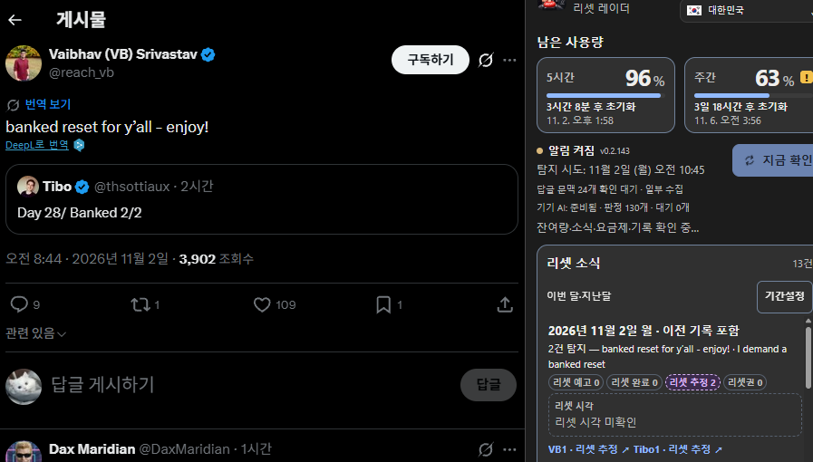
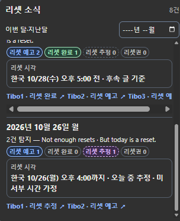

# Codex 리셋 레이더 · 한국어

Codex 사용량과 리셋 소식을 한곳에서 확인하는 **Chrome·Edge 확장 프로그램**입니다. OpenAI·Tibo·VB의 공개 글에서 리셋 관련 소식을 찾아 보여주고, 선택적으로 연결한 계정의 사용량과 Banked reset 리셋권 상태를 확인합니다.

**최신 버전: v0.2.157.** 요금제 자동 확인, 알림 중복 방지와 X 확인 탭 복구를 보완했습니다. 신모델 출시 분류와 리셋권 문맥 판별도 포함합니다.

**OpenAI 공식 제품이 아닌 커뮤니티 파생판입니다.** 공개 글 분류와 Chat 사용량은 추정이 포함될 수 있으며, 공지가 개인 계정에 반영됐는지는 계정 잔여량을 별도로 확인해야 합니다.

[최신 버전 다운로드](https://github.com/Eon12536/codex-reset-radar-ko/releases/latest) · [처음 사용하는 분을 위한 사용법](docs/USAGE.md) · [오류 신고](https://github.com/Eon12536/codex-reset-radar-ko/issues/new?template=bug_report.yml) · [기능 제안](https://github.com/Eon12536/codex-reset-radar-ko/issues/new?template=feature_request.yml)

## 실제 사용 화면

아래는 **사용자가 실제로 사용하면서 제공한 캡처**입니다. 예시 데이터로 만든 화면이 아닙니다. **2026년 11월 2일의 이전 버전 화면**으로, 현재 v0.2.157의 일부 문구·분류·화면 배치는 다를 수 있습니다. 그림 속 잔여량과 날짜는 캡처 당시 값입니다.

### X 원문과 확장 팝업

오른쪽에서 5시간·주간 잔여량, **지금 확인**, 날짜별 소식과 **기간설정**을 볼 수 있습니다. 이 캡처는 v0.2.143이며, 당시 화면에 보이는 Banked 글의 ‘리셋 추정’ 분류는 이후 보완된 부분입니다. 이미지를 눌러 원본 크기로 볼 수 있습니다.

### 날짜별 리셋 소식 상세

날짜별 카드에 분류별 건수·리셋 일정·원문 링크를 모아 보여줍니다. 현재 버전에서는 **기간설정** 버튼으로 과거 월을 선택하고 **신모델 출시**도 별도 분류합니다. [이미지 출처와 캡처 정보](docs/images/README.md)

## 처음 설치한다면

1. [최신 릴리스](https://github.com/Eon12536/codex-reset-radar-ko/releases/latest)의 **Assets**에서 `CodexReset-Radar-KO-버전.zip`을 받습니다. 자동 생성된 `Source code` ZIP 대신 설치용 ZIP을 선택하세요.
2. 계속 보관할 폴더에 압축을 풉니다. Chrome의 `chrome://extensions/` 또는 Edge의 `edge://extensions/`에서 **개발자 모드**를 켭니다.
3. **압축해제된 확장 프로그램을 로드합니다**를 누르고 `manifest.json`이 있는 폴더를 선택합니다.
4. 도구 모음에 확장을 고정한 뒤 **설정 → 감시 설정**에서 X 접근을 허용합니다. 같은 브라우저에서 X에 로그인해야 할 수 있습니다.
5. 팝업의 **지금 확인**을 누르고 수집 상태를 확인합니다. **설정 → 알림 → 테스트 알림**으로 알림 연결도 확인합니다.

**설치한 폴더를 삭제하거나 이동하지 마세요.** 계정 잔여량·리셋권 조회는 선택 기능이며, 원하는 사람만 본인의 ChatGPT 계정을 연결하면 됩니다. [첫 설정과 화면별 사용법 보기 →](docs/USAGE.md)

## 무엇을 할 수 있나요?

| 기능 | 확인할 수 있는 내용 |
| --- | --- |
| 리셋 공지 분류 | 리셋 예고·완료·추정·리셋권·신모델 출시를 구분 |
| 날짜별 요약 | 같은 날의 글을 모아 요약하고 원문 링크 표시 |
| 리셋 시간 | 원문과 확인 가능한 답글의 일정 표현을 선택한 국가 시간대로 표시 |
| Codex 잔여량 | 계정을 연결하면 5시간·주간 잔여량과 초기화 시각 표시 |
| 리셋권 관리 | 계정의 보유·지급·만료 상태와 기본 3일·2일·1일 전 알림 |
| 알림 | 공개 소식 하루 요약, 계정 회복·리셋권 알림, 시작·절전 복귀 후 확인 |
| 과거 기록 | 저장한 소식을 누적하고 이번 달·지난달 또는 선택한 월 조회 |
| 교차 확인 | Telegram 공개 채널의 링크를 후보로 받아 빠진 X 원문 재확인 |
| Chat 집계 | 선택적으로 요금제를 확인하고 확인한 모델 사용 기록 집계 |

## v0.2.157 주요 변경

- **요금제 확인 안정화:** 팝업을 열면 백그라운드에서 현재 구독을 확인합니다. 처음에는 이전 값이 잠시 표시될 수 있으며 최대 45초 동안 같은 확인 탭에서 재시도합니다. 자동 등록 읽기 코드가 시작되지 않아도 현재 구독 카드를 직접 확인하고, 실패 단계도 표시합니다.

- **현재 결제 화면 지원:** 실제 ChatGPT의 /settings/billing 결제 화면과 현재 구독 카드 구조를 지원합니다. 자동 갱신 안내 옆의 현재 요금제만 확인하고 과거 결제 내역·업그레이드 광고는 제외합니다. 현재 구독 카드에서 확인한 Pro 등급이 오래된 로그인·잔여량 응답의 Plus 값으로 다시 바뀌지 않도록 보완했습니다. 기존 수동 선택은 유지하고 확인용 탭은 종료 후 정리합니다.

- **Pro가 Plus로 보이던 경로 보완:** 팝업을 열거나 요금제 자동 확인을 실행할 때, 허용된 계정 조회에서 최신 요금제를 다시 확인합니다. 오래된 로그인 정보와 확인값이 충돌하고 재확인에 실패하면 ‘요금제 미확인’으로 표시합니다. Pro 세부 가격·한도는 임의로 정하지 않습니다.
- **알림 중복·확인 탭 복구:** Chrome이 알림을 접수한 뒤 기록 저장이 실패해도 같은 알림을 다시 보내지 않도록 보완했습니다. 세션 기록이 없어진 확인 탭도 저장된 소유권을 확인해 정리합니다.
- **탐지 보완:** 짧은 Banked 공지, 인용 원문 링크 구분, Telegram 보조 후보와 조회 시간 배분을 보완했습니다. 확인된 OpenAI 신모델 출시는 별도 항목으로 표시합니다.
- **검증:** `npm run verify`의 빌드·확장 검사·회귀 테스트 1,133개 통과. 실제 Chrome 결제 화면의 현재 구독 카드를 확인했고, 사용자 설치본 v0.2.157에서 **Pro $100 · 5x로 전환됨**을 확인했습니다. Windows 알림 수신과 다른 계정·브라우저 환경 전체를 이번 수정에서 실측한 것은 아닙니다.

## 주요 기능

### 리셋 소식 탐지

- OpenAI·Tibo·VB의 공개 글과 확인 가능한 답글에서 리셋 예고, 완료 표현, 리셋 추정과 리셋권 공지를 구분합니다.
- 리셋 관련 글을 날짜별로 묶어 요약하고 작성자·게시 시각·원문 링크를 표시합니다. 확인된 일정 표현은 선택한 국가의 시간대로 변환합니다.
- 리셋권 공지는 계정에 실제로 리셋권이 지급됐다는 증거와 구분합니다. 모호한 내용은 추정으로 표시될 수 있습니다.
- **지금 확인** 버튼으로 수동 조회할 수 있으며, 기본 확인 주기는 15분입니다. Chrome 시작과 절전 복귀 시에도 확인을 시도합니다.
- 확장이 연 X 확인 탭은 조회가 끝나면 정리를 시도합니다. 고정하거나 다른 창·페이지로 이동한 탭, 사용자가 선택한 ChatGPT 확인 탭과 소유권이 불명확한 탭은 보호합니다. 확장이 소유한 X 확인 탭은 탐지가 끝나면 닫습니다.

### 신모델 출시

- OpenAI·Tibo·VB의 확인된 공개 글에서 이름이 명시된 GPT·OpenAI 모델 출시를 별도로 분류합니다. 단순 모델 언급·추측·향후 계획은 확정 출시로 취급하지 않습니다.
- 날짜별 카드에서 **리셋 예고 / 리셋 완료 / 리셋 추정 / 리셋권 / 신모델 출시** 건수를 구분합니다. 탐지된 항목에만 색을 표시합니다.
- 출시 공지를 찾는 기능이며, Chat 모델별 집계표나 계정 사용 한도를 자동으로 변경하지 않습니다.

### 사용량과 리셋권

- 계정 연결을 선택하면 Codex **5시간·주간 잔여량**, 조회 가능한 초기화 시각과 Banked reset 보유·만료 상태를 표시합니다.
- 리셋권 만료 알림이 켜져 있고 만료 시각을 확인할 수 있으면 기본적으로 **3일·2일·1일 전**에 안내합니다. 만료가 가까우면 확장 아이콘에도 표시합니다. `94%!`의 `94%`는 주간 잔여량이고 `!`는 주의할 상태가 있다는 표시입니다. 팝업의 남은 사용량 옆 안내에서 이유를, 리셋권 상태에서 만료일을 확인하세요.
- Chat 모델별 집계와 요금제 확인은 선택 기능입니다. Chat 수치는 확인한 기록에 기반한 **추정치**이며 공식 잔여 횟수가 아닙니다. 삭제된 대화·다른 기기·계정별 정책 등에 따라 차이가 날 수 있습니다.

### 기록과 보조 확인

- 확인된 리셋 소식은 기기에 누적합니다. 기본 화면에는 이번 달과 지난달을 표시하며, **기간설정**에서 연도와 월을 선택할 수 있습니다.
- 선택적으로 Telegram 공개 채널의 X 글 번호를 보조 후보로 사용합니다. 채널 문구만으로 공지를 확정하지 않고 X 원문을 다시 확인합니다. 다른 계정이 원글을 인용한 링크는 인용 원문을 찾아 작성자·글 번호·본문을 재확인합니다. 접근 제한이나 원문 확인 실패 시에는 확정 소식으로 표시하지 않습니다.
- 설정의 **예전 리셋 글 복구**는 공개 기록 사이트에서 Tibo 원문 링크를 후보로 가져온 뒤 X 원문 확인을 시도합니다. 모든 과거 글의 복구는 보장되지 않습니다.

### 알림

- 공개 소식은 기본적으로 **선택 국가의 하루에 한 번** Windows/Chrome 알림을 보냅니다. 같은 날 추가된 글은 팝업에 반영됩니다.
- 잔여량 회복, 리셋권 지급·만료 알림은 공개 소식의 하루 알림과 별도로 설정할 수 있습니다. 과거에 복구한 글은 새 알림으로 다시 보내지 않습니다.
- Chrome이 실행 중이어야 확인할 수 있습니다. Windows 알림 허용·방해 금지 설정과 Chrome 알림 설정에 따라 표시나 소리가 달라질 수 있습니다.

## 설치

1. [최신 릴리스](https://github.com/Eon12536/codex-reset-radar-ko/releases/latest)에서 `CodexReset-Radar-KO-0.2.157.zip`을 다운로드하고 압축을 풉니다.
2. Chrome에서 `chrome://extensions/`, Edge에서 `edge://extensions/`를 열고 **개발자 모드**를 켭니다.
3. **압축해제된 확장 프로그램을 로드합니다**를 선택하고 `manifest.json`이 들어 있는 폴더를 지정합니다.
4. 브라우저 도구 모음에 확장을 고정합니다. X 직접 확인은 설정에서 접근을 한 번 허용해야 하며, X 로그인 상태가 필요할 수 있습니다.
5. 개인 사용량과 리셋권을 보려면 설정에서 계정 조회를 선택하고 ChatGPT 계정을 연결합니다.

## 업데이트

최신 ZIP의 파일을 기존 설치 폴더에 덮어쓴 다음 확장 관리에서 **새로고침**하세요. 같은 확장을 삭제하지 않고 업데이트하면 기존 로컬 설정과 기록을 유지할 수 있습니다. ZIP으로 설치한 확장은 자동 업데이트되지 않습니다.

## 사용 조건과 한계

- X 로그인 상태, 페이지 구조 변경, 네트워크 문제와 접근 제한에 따라 글 수집이 실패하거나 일부 소식을 놓칠 수 있습니다. 모든 공지의 탐지를 보장하지 않습니다.
- 리셋의 정확한 시각이나 종류가 원문에 없으면 확정하지 않습니다. 상대 날짜와 시간대는 원문·게시일에 근거한 해석으로, 실제 실행 시점과 다를 수 있습니다.
- Chrome 내장 **기기 AI**를 사용할 수 있는 경우 공개 글의 의미 판정을 보조합니다. 지원 기기와 모델 준비가 필요하며 AI도 틀릴 수 있습니다. 이 기능은 유료 Claude API나 Codex 추론 토큰을 사용하지 않습니다.
- Chat 모델 분류와 한도 기준은 확장에 포함된 표를 사용합니다. 새 모델이나 정책이 나오면 자동으로 정확한 수치가 갱신되는 것은 아니며 확장 업데이트가 필요할 수 있습니다.

## 권한과 개인정보

확장 기능에 필요한 권한과 사용 목적은 다음과 같습니다.

| 권한 | 용도 |
| --- | --- |
| 알람·알림 | 정기 확인과 브라우저 알림 |
| 저장소·확장 저장소 | 설정, 확인 상태와 공개 소식 기록을 기기에 보관 |
| X 접근·스크립트 실행 | 사용자가 허용한 경우 공개 글·답글 확인 |
| Telegram 접근 | 사용자가 연결한 경우 공개 채널에서 X 글 번호를 보조 확인 |
| ChatGPT 및 공개 소스 접근 | 선택한 계정 정보와 공개 소식 조회 |

X·Telegram·공개 기록 사이트를 이용할 때 해당 서비스에 접속 IP 등 통상적인 연결 정보가 전달될 수 있습니다. 보관·전송과 선택 권한의 자세한 내용은 [개인정보 처리 안내](PRIVACY.md)를 확인하세요.

## 피드백과 기여

문제를 발견하면 [오류 신고](https://github.com/Eon12536/codex-reset-radar-ko/issues/new?template=bug_report.yml)에 확장 버전, 브라우저, 재현 순서와 공개 원문 링크를 남겨 주세요. 아이디어는 [기능 제안](https://github.com/Eon12536/codex-reset-radar-ko/issues/new?template=feature_request.yml)으로 환영합니다.

스크린샷을 공유할 때는 개인정보를 가리고, 토큰·쿠키·계정 ID·대화 본문·원본 API 응답은 올리지 마세요. [상세 한국어 설명과 변경 이력](README.ko.md) · [기여 방법](CONTRIBUTING.md)

## 개발과 라이선스

Node.js 20.11 이상에서 `npm ci` 후 `npm run verify`를 실행합니다. 패키징·확장 검사·회귀 테스트가 실행되고 ZIP이 `dist/`에 생성됩니다. `node scripts/preview-server.mjs`의 화면은 예시 데이터이며 실제 Windows 알림 검증을 대신하지 않습니다.

이 프로젝트는 [whmc76/codex-reset-radar](https://github.com/whmc76/codex-reset-radar) 기반 커뮤니티 파생판입니다. [MIT 라이선스](LICENSE)와 [제3자 자산 고지](THIRD_PARTY_NOTICES.md)를 확인하세요.
